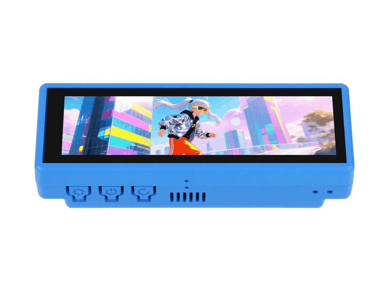

# 🎙️ DeskBar AI — Autonomous AI Voice Assistant & Smart Desktop Bar
*(Evolved from upstream TuneBar)*


-green)


**DeskBar AI** is an extensive architectural evolution of the TuneBar project for the official [Waveshare ESP32-S3-Touch-LCD-3.49](https://docs.waveshare.com/ESP32-S3-Touch-LCD-3.49?variant=ESP32-S3-Touch-LCD-3.49) development platform. What began as a palm-sized internet radio has been re-engineered into an autonomous **AI Voice Assistant**, smart desktop companion, and distributed telemetry station with high-fidelity acoustic processing, advanced power and breathing profile management, dynamic crowd-sourced battery discharge calibration, 6-axis digital spirit level, 6-language international radio, local SD & LAN media streaming, zero-bitmap procedural vector themes, and complete privacy controls.

---

## 📑 Quick Navigation

* [📦 Hardware Overview](#-hardware-overview)
* [📸 Interface Showcase (Authentic Hardware Captures)](#-interface-showcase)
* [⚡ Why DeskBar AI is Different](#-why-deskbar-ai-is-different)
* [⚡ Quickstart & Flash Guide](#-quickstart--flash-guide)
* [📚 Detailed Technical Documentation](#-detailed-technical-documentation)
* [🛒 Where to Buy Genuine Hardware](#-where-to-buy)
* [📜 Credits & License](#-credits--license)
* [☕ Support DeskBar AI](#-support-deskbar-ai)

---

## 📦 Hardware Overview

DeskBar AI runs on the 3.49-inch capacitive touch screen development board powered by the **ESP32-S3R8** (dual-core 240 MHz, 16MB Flash, 8MB OPI PSRAM) with an integrated acoustic front-end (dual MEMS microphones + ES7210 ADC), audio codec (ES8311 DAC + NS4150B amplifier), 6-axis IMU, and RTC:

<p align="center">
  
</p>

*Complete pinouts, wiring diagrams, and silicon driver workarounds are documented in [docs/HARDWARE_AND_DRAM.md](docs/HARDWARE_AND_DRAM.md).*

---

## 📸 Interface Showcase

*All captures shown below are 100% genuine uncompressed framebuffers extracted directly from the physical ESP32-S3 hardware via `/api/screenshot`.*

<table>
  <thead>
    <tr>
      <th width="58%">Application Interface &amp; Dynamic Panels</th>
      <th width="42%">Feature Architecture &amp; Operating Details</th>
    </tr>
  </thead>
  <tbody>
    <tr>
      <td align="center">
        <b>First-Boot Security &amp; Master PIN</b><br>
        <a href="document/app_security.gif"></a><br>
        <small><i>(Cycles between Masked State &amp; TRNG PIN Setup)</i></small>
      </td>
      <td>
        <small>
          <b>Privacy-First Hardware Cryptography &amp; Dynamic TOTP</b><br>
          • <b>Interactive 2-Column Registration Modal</b>: Configure a 4-digit Master PIN or rely on hardware TRNG.<br>
          • <b>Isolated SHA-256 Telemetry Table</b>: <code>TB_&lt;hash&gt;</code> with prominent live preview.<br>
          • <b>Hardware-Bound Dynamic TOTP</b>: 6-digit rolling code (<code>[ xxx xxx ]</code>) with renewal countdown timer.<br>
          • <b>30-Day Authenticated Web Session</b>: Zero personal data collected; complete offline air-gapped mode toggle.
        </small>
      </td>
    </tr>
    <tr>
      <td align="center">
        <b>Main Menu Launcher Carousel</b><br>
        <a href="document/app_menu.gif"></a><br>
        <small><i>(Smooth horizontal scrolling across all 6 application cards)</i></small>
      </td>
      <td>
        <small>
          <b>Neon Card-Based Navigation Hub</b><br>
          • <b>Ultra-Crisp 640×172 Carousel</b>: Horizontal swipe launcher featuring 6 custom neon application cards.<br>
          • <b>Visual Categories</b>: <b>CLIMATE</b> (Cyan), <b>RADIO</b> (Pink), <b>MUSIC</b> (Purple), <b>AI VOICE</b> (Emerald), <b>SYSTEM</b> (Gold), and <b>SETTINGS</b> (Slate).<br>
          • <b>Ambient Audio Breathing</b>: Active card pulses gently in rhythm with background playback.<br>
          • <b>Inertial Touch Scrolling</b>: Responsive touch drag with snappy center-screen snapping.
        </small>
      </td>
    </tr>
    <tr>
      <td align="center">
        <b>Clock, Weather &amp; Alarm Suite</b><br>
        <a href="document/app_clock.gif"></a><br>
        <small><i>(Cycles through Retro Nixie Clock, Weather &amp; Retro Alarm)</i></small>
      </td>
      <td>
        <small>
          <b>Ambient Time, Environmental Telemetry &amp; Wake Station</b><br>
          • <b>Retro Nixie Clock Face</b>: Driven by hardware <b>PCF85063 RTC</b> with battery telemetry and PWM sine-wave breathing.<br>
          • <b>Live Climate &amp; AQI Station</b>: Real-time observations with animated glyphs, °C/°F toggle, and US Air Quality Index (AQI &amp; PM2.5).<br>
          • <b>Retro Alarm Clock</b>: Emerald-green wake station driven by hardware RTC alarm register with acoustic chime.
        </small>
      </td>
    </tr>
    <tr>
      <td align="center">
        <b>Multilingual Global Internet Radio</b><br>
        <a href="document/app_radio.gif"></a><br>
        <small><i>(Cycles through Hindi, English &amp; German streaming with live telemetry)</i></small>
      </td>
      <td>
        <small>
          <b>International 6-Language Live Streaming &amp; Stream Telemetry</b><br>
          • <b>6 International Languages</b>: Worldwide internet radio supporting <b>HI</b>, <b>EN</b>, <b>ES</b>, <b>CN</b>, <b>DE</b>, <b>JA</b>.<br>
          • <b>Real-Time Stream Quality Telemetry</b>: Live top-row display of audio bitrate, download speed, and jitter buffer percentage with dynamic green/amber/red health indicators.<br>
          • <b>Curated Regional Catalogs</b>: Instant switching between Indian stations and global stream directories.<br>
          • <b>Zero-Alloc PSRAM Prebuffering</b>: 64 KB ring buffer with seamless background streaming while switching screens.<br>
          • <b>Custom Station Import</b>: MicroSD <code>/stations.csv</code> hot-reloading.
        </small>
      </td>
    </tr>
    <tr>
      <td align="center">
        <b>Media Player Subsystem (SD &amp; LAN)</b><br>
        <a href="document/app_music.gif"></a><br>
        <small><i>(Cycles between Local SD Playback &amp; LAN Streaming)</i></small>
      </td>
      <td>
        <small>
          <b>Unified Dual-Engine Audio Player</b><br>
          • <b>Local SD FATFS Engine</b>: Reads tracks from MicroSD with $O(1)$ fast PSRAM offset indexing.<br>
          • <b>DMA-Safe PSRAM Streaming</b>: Internal DRAM bounce buffer for SPI SD DMA compatibility, eliminating PSRAM bus contention and memory panics.<br>
          • <b>Local Wi-Fi LAN Engine</b>: Streams lossless audio directly over HTTP from home music servers.<br>
          • Real-time waveform animation, progress scrubber, and volume control.
        </small>
      </td>
    </tr>
    <tr>
      <td align="center">
        <b>Autonomous AI Voice Assistant</b><br>
        <a href="document/screen_assistant.png"></a>
      </td>
      <td>
        <small>
          <b>Full-Duplex Voice Intelligence Pipeline</b><br>
          • <b>Acoustic Precision</b>: Dual MEMS microphones with <b>ES7210 ADC</b> hardware clock divider calibration eliminating buffer popping.<br>
          • <b>Adaptive Hardware VAD</b>: Dynamically measures room ambient noise floor on boot to prevent false triggers.<br>
          • <b>Sub-Second Streaming Pipeline</b>: Groq Whisper STT (&lt;200ms) and Llama 3.3 70B reasoning stream directly into I2S DMA pipeline without temporary flash writes.<br>
          • Interactive touch trigger with acoustic playback via NS4150B amplifier.
        </small>
      </td>
    </tr>
    <tr>
      <td align="center">
        <b>System Utilities &amp; App Launcher</b><br>
        <a href="document/screen_utility_5apps.png"></a>
      </td>
      <td>
        <small>
          <b>5-in-1 Quick-Access Toolkit</b><br>
          • <b>Torch</b>: Instant 100% full-screen pure white backlight flashlight.<br>
          • <b>System Info</b>: Live DRAM and PSRAM heap gauges, FreeRTOS task stacks, uptime, and supply rails.<br>
          • <b>Spirit Level</b>: Quick launcher for the 6-axis digital inclinometer.<br>
          • <b>Power Profile</b>: Dedicated shortcut to the battery &amp; breathing optimization suite.<br>
          • <b>Firmware OTA</b>: Direct launch into the community release manager.
        </small>
      </td>
    </tr>
    <tr>
      <td align="center">
        <b>6-Axis Digital Spirit Level &amp; Inclinometer</b><br>
        <a href="document/app_spirit_level.gif"></a><br>
        <small><i>(Cycles through Digital Pitch/Roll, Bullseye &amp; Calibration)</i></small>
      </td>
      <td>
        <small>
          <b>Precision Motion &amp; Tilt Sensor</b><br>
          • <b>QMI8658 6-Axis IMU</b>: Real-time digital pitch and roll telemetry.<br>
          • <b>Dual Operating Views</b>: Numeric inclinometer angle readout and a responsive 2D bullseye bubble level.<br>
          • <b>8-Step Guided Calibration Wizard</b>: Calibrates zero-point offsets in NVS across 3 spatial planes.<br>
          • Dynamic auto-rotation display support based on gravity vector.
        </small>
      </td>
    </tr>
    <tr>
      <td align="center">
        <b>On-Device Firmware OTA Manager</b><br>
        <a href="document/app_ota.gif"></a><br>
        <small><i>(Cycles through Repos, Catalog Carousel &amp; Stepper)</i></small>
      </td>
      <td>
        <small>
          <b>Decentralized Multi-Repo Release Manager</b><br>
          • <b>Dynamic Community Discovery</b>: Dynamic release catalog generation across multiple GitHub community repositories.<br>
          • <b>Multi-Partition Flashing</b>: Automated rollback protection and SHA-256 binary validation.<br>
          • <b>Battery Safety Interlock</b>: Voltage safety guards preventing flashing under low-battery conditions.<br>
          • Swipe-based carousel with live changelog viewer and step-by-step progress stepper.
        </small>
      </td>
    </tr>
    <tr>
      <td align="center">
        <b>Power &amp; Breathing Profile Manager</b><br>
        <a href="document/app_power_profile.gif"></a><br>
        <small><i>(Cycles between Breathing Controls &amp; Cloud Calibration)</i></small>
      </td>
      <td>
        <small>
          <b>Intelligent Battery &amp; Energy Optimization</b><br>
          • <b>Sine-Wave PWM Breathing</b>: Interactive scrollable manager for PWM floor/ceiling, ramp times, and dark holds.<br>
          • <b>Peripheral Power Gating</b>: Selectively shuts down audio amp, IMU sensor, and Wi-Fi modem during dark breathing states.<br>
          • <b>Piecewise Linear Curve Fitting</b>: Multi-point piecewise linear discharge curve fitting saved in NVS.<br>
          • <b>Crowd-Sourced Cloud Calibration</b>: Pulls verified golden discharge curves from peer telemetry with source and timestamp verification.
        </small>
      </td>
    </tr>
    <tr>
      <td align="center">
        <b>System &amp; Display Settings</b><br>
        <a href="document/app_settings.gif"></a><br>
        <small><i>(Cycles in tab order: Wi-Fi, Screen, Radio, Music, Region, User Guide)</i></small>
      </td>
      <td>
        <small>
          <b>Complete Hardware &amp; Configuration Control</b><br>
          • <b>Zero-Recompile MicroSD Hot-Reload</b>: Update Wi-Fi networks, PINs, and API keys via <code>/secrets.ini</code>—no toolchain or compiling required.<br>
          • <b>Multi-SSID Wi-Fi Manager</b>: Stores up to 10 network slots with live RSSI signal telemetry.<br>
          • <b>7 Zero-Bitmap Procedural Themes</b>: Math-generated vector themes consuming <b>0 bytes of flash image memory</b>, keeping DRAM free.<br>
          • <b>Global Localization</b>: Timezone offsets with IP geolocation and complete on-device touch user guide.
        </small>
      </td>
    </tr>
  </tbody>
</table>

---

## ⚡ Why DeskBar-AI is Different

DeskBar-AI bridges the gap between commercial smart displays and open-source hardware by solving notorious ESP32-S3 silicon quirks:

| ⚡ Silicon & Audio Architecture | 🔋 Mathematical Battery Science |
| :--- | :--- |
| • **ES7210 Clock Jitter Calibration**: Custom register MCLK/BCLK divider fixes eliminating audio popping.<br>• **DMA-Safe PSRAM Bounce Buffers**: Zero bus contention or DRAM starvation during high-bitrate streaming.<br>• **Non-Resetting Serial Diagnostic**: Custom monitor script preventing unwanted ESP32 DTR/RTS auto-resets. | • **Piecewise Linear Curve Fitting**: Replaces inaccurate linear estimates with true battery discharge physics.<br>• **Crowd-Sourced Cloud Sync**: One-tap sync with golden peer discharge curves via telemetry.<br>• **Peripheral Power Gating**: Shuts down amplifier, IMU, and radio during dark breathing intervals. |
| **🎙️ Sub-Second Streaming AI Pipeline** | **🔓 Zero-Recompile Consumer Polish** |
| • **Sub-200ms Whisper & Llama 3.3 70B**: Neural TTS streams straight into I2S DMA with zero flash wear.<br>• **Adaptive Hardware VAD**: Dynamic ambient room noise floor calibration.<br>• **Air-Gapped Privacy**: 100% offline mode with hardware TRNG PIN generation. | • **MicroSD `/secrets.ini` Hot-Reloading**: Change Wi-Fi, keys, and settings on SD—no IDE or recompiling.<br>• **On-Device GitHub OTA Manager**: Browse releases, inspect changelogs on LCD, and flash safely.<br>• **Web Remote REST & SSE**: 10 Hz real-time motion telemetry and uncompressed framebuffer streaming. |

---

<details>
<summary><b>⚡ Quickstart &amp; Flash Guide (Click to expand build &amp; upload instructions)</b></summary>
<br>

### 1. Clone & Set Up Secrets Template
```bash
git clone https://github.com/rahulraj80/DeskBar-AI.git
cd DeskBar-AI

# Set up secrets template
cp sketch/include/secrets_example.h sketch/include/secrets.h
```

### 2. Compile via PlatformIO
```bash
pio run -d sketch
```

### 3. Flash to Board via USB
Connect the board to your PC via USB-C:
```bash
# Upload firmware
pio run -d sketch -t upload

# Open safe non-resetting serial monitor
python scripts/safe_serial_monitor.py listen --duration 20
```

</details>

---

## 📚 Detailed Technical Documentation

To keep this overview concise, detailed architecture guides are organized in the [`docs/`](docs/) directory:

* **[🛠️ Environment Setup & Cross-Platform Build Guide](docs/BUILD_GUIDE.md)**: Full compilation, LittleFS packaging, and flashing guide for Windows, Linux, and macOS.
* **[🎙️ Autonomous AI Voice Assistant & Self-Hosting Guide](docs/AI_VOICE_ASSISTANT.md)**: Voice pipeline architecture, self-hosting FastAPI reference server, and community bandwidth notices.
* **[🔒 Privacy, First-Boot Consent & Telemetry](docs/CONSENT_AND_TELEMETRY.md)**: Hardware TRNG PIN setup, SHA256 isolated database tables, and `/secrets.ini` configuration.
* **[📖 Touch Gestures & Complete User Guide](docs/USER_GUIDE.md)**: Comprehensive gesture maps, screen switching hierarchies, and settings configuration.
* **[⚡ Hardware Pinouts, Silicon Quirks & DRAM Optimization](docs/HARDWARE_AND_DRAM.md)**: Deep-dive into ES7210 clock divider fixes, DMA frame stride unpacking, and FreeRTOS PSRAM optimization.
* **[🔊 Audio Pipeline & Microphone Hardware Master Reference](docs/AUDIO_HARDWARE_LEARNINGS.md)**: In-depth ES7210/ES8311 I2S register maps, gain staging, and DMA double-buffering.
* **[🌐 Web Remote REST API & Serial CLI](docs/REST_API_AND_CLI.md)**: Complete table of embedded HTTP REST endpoints and interactive USB CLI commands.
* **[📐 6-Axis IMU, Spirit Level & Auto-Rotation](docs/IMU_AND_SPIRIT_LEVEL.md)**: Inclinometer physics, bullseye bubble mechanics, and 8-step guided calibration wizard.
* **[🔄 On-Device Multi-Repo Firmware OTA Manager](docs/FIRMWARE_OTA.md)**: Split carousel UI, dynamic GitHub catalog generation, and battery safety guards.

---

## 🛒 Where to Buy Genuine Hardware

For makers looking to replicate this device:
* **🇮🇳 India (Hindi / HI)**: [Evelta Electronics](https://www.evelta.com) (Search SKU `061-32374` / *Waveshare ESP32-S3 Touch LCD 3.49*).
* **🌐 Global / North America (English / EN & Spanish / ES)**: [Waveshare Official Store](https://www.waveshare.com/esp32-s3-touch-lcd-3.49.htm) and official stores on AliExpress.
* **🇪🇺 Europe / DACH (German / DE)**: [BerryBase](https://www.berrybase.de) and [Welectron](https://www.welectron.com).
* **🇯🇵 Japan (Japanese / JA)**: [Switch Science](https://www.switch-science.com).

*Community Notice: None of the above are affiliate links; links are provided strictly for maker convenience.*

---

## 📜 Credits & License
 
* Original TuneBar project foundation by **[VaAndCob](https://github.com/VaAndCob/TuneBar)**.
* Core audio functionality powered by the **[ESP32-audioI2S](https://github.com/schreibfaul1/ESP32-audioI2S)** library.
* UI engine powered by **[LVGL 8.4.0](https://lvgl.io/)**.
* Advanced Audio Engineering, ES7210 driver fixes, DRAM optimization, power saving architecture, multilingual radio expansion, 6-axis instruments, and AI Voice Assistant by **Rahul Raj** ([@rahulraj80](https://github.com/rahulraj80)).

This software and firmware codebase is licensed under the **GNU General Public License v3.0 (GPL-3.0)** (see [`LICENSE`](LICENSE)). Any hardware designs, UI assets, and media components derived from upstream TuneBar remain licensed under the [Creative Commons Attribution-NonCommercial-ShareAlike 4.0 International (CC BY-NC-SA 4.0)](https://creativecommons.org/licenses/by-nc-sa/4.0/) license. Attribution to original author Va&Cob and contributing author Rahul Raj is required on all derivative distributions.

---

## ☕ Support DeskBar AI

DeskBar AI is free and open-source. [Click here to support the Original Upstream Repo by VaAndCob](https://github.com/VaAndCob/TuneBar#license)

If you enjoyed DeskBar AI with the new autonomous voice assistant and desktop instrument bar features - please click below to support the continued development of DeskBar AI.

DeskBar AI is 100% free, open-source, and privacy-respecting. Your sponsorship directly funds:
* 🧠 **AI Tokens & Inference**: Groq Whisper STT and Llama 3.3 70B cloud inference for live community testing and development.
* 🔬 **Hardware Lab Testing**: Acoustic tuning for the ES7210 ADC, NS4150B amplifier thermal stress tests, and I2C/SPI bus stability.
* 🌐 **Community Cloud Infrastructure**: Maintaining the cloud OTA release catalog and crowd-sourced battery telemetry servers.

Every little bit helps keep the project active and maintained.

<p align="center">
  <a href="https://razorpay.me/@rahulraj593" target="_blank" rel="noopener noreferrer">
    
  </a>
</p>

*International supporters: click the card above to pay by card or PayPal via Razorpay. In India: scan the UPI QR in the card, or pay to **`rahul.raj@okicici`**.*
