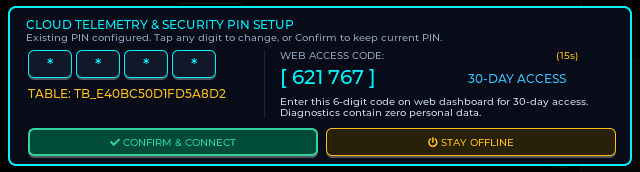
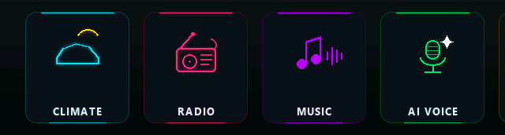
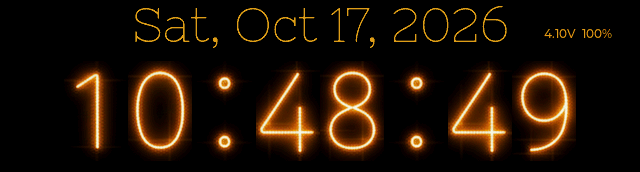
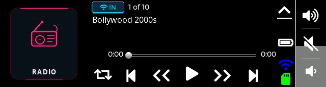
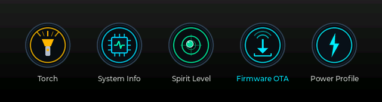
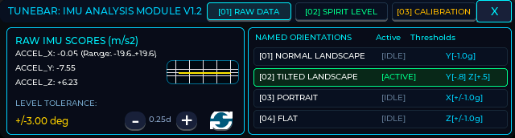
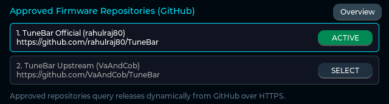
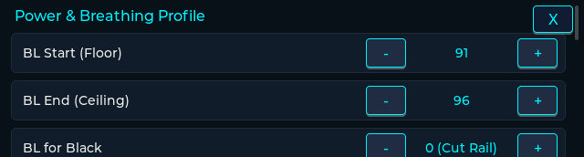
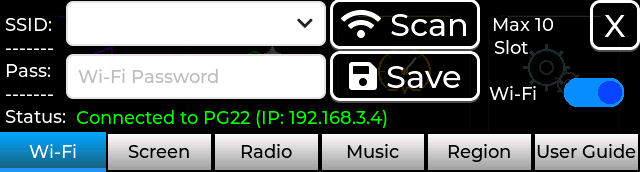

# 🎙️ DeskBar AI — Autonomous AI Voice Assistant & Smart Desktop Bar
*(Evolved from upstream TuneBar)*


-green)


**DeskBar AI** is an extensive architectural evolution of the TuneBar project for the official [Waveshare ESP32-S3-Touch-LCD-3.49](https://docs.waveshare.com/ESP32-S3-Touch-LCD-3.49?variant=ESP32-S3-Touch-LCD-3.49) development platform. What began as a palm-sized internet radio has been re-engineered into an autonomous **AI Voice Assistant**, smart desktop companion, and distributed telemetry station with high-fidelity acoustic processing, advanced power and breathing profile management, dynamic crowd-sourced battery discharge calibration, 6-axis digital spirit level, 6-language international radio, local SD & LAN media streaming, zero-bitmap procedural vector themes, and complete privacy controls.

---

## 📑 Quick Navigation

* [📦 Hardware Overview](#-hardware-overview)
* [📸 Interface Showcase (Authentic Hardware Captures)](#-interface-showcase)
* [⚡ Why DeskBar AI is Different](#-why-deskbar-ai-is-different)
* [⚡ Quickstart & Flash Guide](#-quickstart--flash-guide)
* [📚 Detailed Technical Documentation](#-detailed-technical-documentation)
* [🛒 Where to Buy Genuine Hardware](#-where-to-buy)
* [📜 Credits & License](#-credits--license)
* [☕ Support DeskBar AI](#-support-deskbar-ai)

---

## 📦 Hardware Overview

DeskBar AI runs on the 3.49-inch capacitive touch screen development board powered by the **ESP32-S3R8** (dual-core 240 MHz, 16MB Flash, 8MB OPI PSRAM) with an integrated acoustic front-end (dual MEMS microphones + ES7210 ADC), audio codec (ES8311 DAC + NS4150B amplifier), 6-axis IMU, and RTC:

<p align="center">
  
  
</p>
<p align="center">
  
  
</p>

*Complete pinouts, wiring diagrams, and silicon driver workarounds are documented in [docs/HARDWARE_AND_DRAM.md](docs/HARDWARE_AND_DRAM.md).*

---

## 📸 Interface Showcase

*All captures shown below are 100% genuine uncompressed framebuffers extracted directly from the physical ESP32-S3 hardware via `/api/screenshot`.*

| Application Interface & Dynamic Panels | Feature Architecture & Operating Details |
| :---: | :--- |
| **First-Boot Security & Master PIN**<br>[](document/app_security.gif)<br>*(Cycles between Consent Notice & TRNG PIN Setup)* | **Privacy-First Hardware Cryptography**<br>• Interactive registration modal on very first boot: configure a 4-digit Master PIN or rely on hardware TRNG.<br>• Isolated SHA-256 telemetry table generation (`TB_<hash>`) ensuring zero cross-contamination of device logs.<br>• Complete 100% offline mode toggle for air-gapped deployments.<br>• Zero personal identification data collected; self-hostable via local `/secrets.ini`. |
| **Main Menu Launcher Carousel**<br>[](document/app_menu.gif)<br>*(Smooth horizontal scrolling across all 6 application cards)* | **Neon Card-Based Navigation Hub**<br>• Ultra-crisp $640\times172$ horizontal swipe launcher carousel featuring 6 custom neon cards.<br>• Visual categories: **CLIMATE** (Cyan), **RADIO** (Pink), **MUSIC** (Purple), **AI VOICE** (Emerald), **SYSTEM** (Gold), and **SETTINGS** (Slate).<br>• Ambient audio breathing: Active card pulses gently in rhythm with background playback.<br>• Inertial touch scrolling with snappy snapping to center screen. |
| **Clock, Weather & Alarm Suite**<br>[](document/app_clock.gif)<br>*(Cycles through Retro Nixie Clock, Weather & Retro Alarm)* | **Ambient Time, Environmental Telemetry & Wake Station**<br>• **Retro Nixie Clock Face**: Driven by hardware **PCF85063 RTC** with battery telemetry and PWM sine-wave breathing.<br>• **Live Climate & AQI Station**: Real-time local observations with animated condition glyphs, °C/°F toggle, and US Air Quality Index (AQI & PM2.5).<br>• **Retro Alarm Clock**: Emerald-green wake station driven by hardware RTC alarm register with acoustic test chime. |
| **Multilingual Global Internet Radio**<br>[](document/app_radio.gif)<br>*(Cycles through Hindi, English & German streaming)* | **International 6-Language Live Streaming**<br>• Worldwide internet radio tuner natively supporting 6 international languages (**HI**, **EN**, **ES**, **CN**, **DE**, **JA**).<br>• Dynamic catalog switching between curated Indian stations ([OnlineRadioFM.in](https://onlineradiofm.in), [RadioIndia.in](https://radioindia.in)) and global stream directories.<br>• Zero-alloc ring buffer prebuffering (64 KB) with seamless background streaming while switching screens.<br>• Custom station import support via `/stations.csv` on the MicroSD card. |
| **Media Player Subsystem (SD & LAN)**<br>[](document/app_music.gif)<br>*(Cycles between Local SD Playback & LAN Streaming)* | **Unified Dual-Engine Audio Player**<br>• **Local SD FATFS Engine**: Reads tracks from MicroSD with $O(1)$ fast PSRAM offset indexing.<br>• **DMA-Safe PSRAM Streaming**: Employs an internal DRAM bounce buffer for SPI SD DMA compatibility, eliminating ESP32-S3 PSRAM bus contention and memory panics.<br>• **Local Wi-Fi LAN Engine**: Streams lossless audio directly over HTTP from home music servers.<br>• Real-time audio waveform animation, progress scrubber, and volume control. |
| **Autonomous AI Voice Assistant**<br>[](document/screen_assistant.png) | **Full-Duplex Voice Intelligence Pipeline**<br>• **Acoustic Precision**: Dual MEMS microphones with **ES7210 ADC** hardware clock divider calibration eliminating buffer popping.<br>• **Adaptive Hardware VAD**: Dynamically measures room ambient noise floor on boot to prevent false triggers.<br>• **Sub-Second Streaming Pipeline**: Groq Whisper STT (<200ms) and Llama 3.3 70B reasoning stream directly into the I2S DMA pipeline without temporary flash writes.<br>• Hands-free interactive touch trigger with acoustic audio playback via NS4150B amplifier. |
| **System Utilities & App Launcher**<br>[](document/screen_utility_5apps.png) | **5-in-1 Quick-Access Toolkit**<br>• **Torch**: Instant 100% full-screen pure white backlight flashlight.<br>• **System Info**: Live DRAM and PSRAM heap gauges, FreeRTOS task stacks, uptime, and supply rails.<br>• **Spirit Level**: Quick launcher for the 6-axis digital inclinometer.<br>• **Power Profile**: Dedicated shortcut to the battery & breathing optimization suite.<br>• **Firmware OTA**: Direct launch into the community release manager. |
| **6-Axis Digital Spirit Level & Inclinometer**<br>[](document/app_spirit_level.gif)<br>*(Cycles through Digital Pitch/Roll, Bullseye & Calibration)* | **Precision Motion & Tilt Sensor**<br>• Hardware **QMI8658 6-axis IMU** with real-time digital pitch and roll telemetry.<br>• **Dual Operating Views**: Numeric inclinometer angle readout and a responsive 2D bullseye bubble level.<br>• **8-Step Guided Calibration Wizard**: Calibrates zero-point offsets in NVS across 3 spatial planes.<br>• Auto-rotation screen orientation support based on gravity vector. |
| **On-Device Firmware OTA Manager**<br>[](document/app_ota.gif)<br>*(Cycles through Repos, Catalog Carousel & Stepper)* | **Decentralized Multi-Repo Release Manager**<br>• Dynamic discovery and release catalog generation across multiple GitHub community repositories.<br>• Multi-partition flashing with automated rollback protection and SHA-256 binary validation.<br>• Built-in battery voltage safety interlocks preventing bricking during low-battery conditions.<br>• Intuitive swipe-based release carousel with live changelog viewer and step-by-step progress stepper. |
| **Power & Breathing Profile Manager**<br>[](document/app_power_profile.gif)<br>*(Cycles between Breathing Controls & Cloud Calibration)* | **Intelligent Battery & Energy Optimization**<br>• **Sine-Wave PWM Breathing**: Interactive scrollable manager for PWM floor/ceiling, ramp times, and dark holds.<br>• **Peripheral Power Gating**: Selectively shuts down audio amp, IMU sensor, and Wi-Fi modem during dark breathing states.<br>• **Mathematical Curve Fitting**: Multi-point piecewise linear discharge curve fitting saved in NVS.<br>• **Crowd-Sourced Cloud Calibration**: Pulls verified golden discharge curves from peer telemetry with source and timestamp verification. |
| **System & Display Settings**<br>[](document/app_settings.gif)<br>*(Cycles in tab order: Wi-Fi, Screen, Radio, Music, Region, User Guide)* | **Complete Hardware & Configuration Control**<br>• **Zero-Recompile MicroSD Hot-Reload**: Update Wi-Fi networks, PINs, and API keys via `/secrets.ini`—no toolchain or compiling required.<br>• **Multi-SSID Wi-Fi Manager**: Stores up to 10 network slots with live RSSI signal telemetry.<br>• **7 Zero-Bitmap Procedural Themes**: Math-generated vector themes consuming **0 bytes of flash image memory**, keeping DRAM free.<br>• **Global Localization**: Timezone offsets with IP geolocation and complete on-device touch user guide. |

---

## ⚡ Why DeskBar-AI is Different

DeskBar-AI bridges the gap between commercial smart displays and open-source hardware by solving notorious ESP32-S3 silicon quirks:

| ⚡ Silicon & Audio Architecture | 🔋 Mathematical Battery Science |
| :--- | :--- |
| • **ES7210 Clock Jitter Calibration**: Custom register MCLK/BCLK divider fixes eliminating audio popping.<br>• **DMA-Safe PSRAM Bounce Buffers**: Zero bus contention or DRAM starvation during high-bitrate streaming.<br>• **Non-Resetting Serial Diagnostic**: Custom monitor script preventing unwanted ESP32 DTR/RTS auto-resets. | • **Piecewise Linear Curve Fitting**: Replaces inaccurate linear estimates with true battery discharge physics.<br>• **Crowd-Sourced Cloud Sync**: One-tap sync with golden peer discharge curves via telemetry.<br>• **Peripheral Power Gating**: Shuts down amplifier, IMU, and radio during dark breathing intervals. |
| **🎙️ Sub-Second Streaming AI Pipeline** | **🔓 Zero-Recompile Consumer Polish** |
| • **Sub-200ms Whisper & Llama 3.3 70B**: Neural TTS streams straight into I2S DMA with zero flash wear.<br>• **Adaptive Hardware VAD**: Dynamic ambient room noise floor calibration.<br>• **Air-Gapped Privacy**: 100% offline mode with hardware TRNG PIN generation. | • **MicroSD `/secrets.ini` Hot-Reloading**: Change Wi-Fi, keys, and settings on SD—no IDE or recompiling.<br>• **On-Device GitHub OTA Manager**: Browse releases, inspect changelogs on LCD, and flash safely.<br>• **Web Remote REST & SSE**: 10 Hz real-time motion telemetry and uncompressed framebuffer streaming. |

---

## ⚡ Quickstart & Flash Guide

### 1. Clone & Set Up Secrets Template
```bash
git clone https://github.com/rahulraj80/DeskBar-AI.git
cd DeskBar-AI

# Set up secrets template
cp sketch/include/secrets_example.h sketch/include/secrets.h
```

### 2. Compile via PlatformIO
```bash
pio run -d sketch
```

### 3. Flash to Board via USB
Connect the board to your PC via USB-C:
```bash
# Upload firmware
pio run -d sketch -t upload

# Open safe non-resetting serial monitor
python scripts/safe_serial_monitor.py listen --duration 20
```

---

## 📚 Detailed Technical Documentation

To keep this overview concise, detailed architecture guides are organized in the [`docs/`](docs/) directory:

* **[🎙️ Autonomous AI Voice Assistant & Self-Hosting Guide](docs/AI_VOICE_ASSISTANT.md)**: Voice pipeline architecture, self-hosting FastAPI reference server, and community bandwidth notices.
* **[🔒 Privacy, First-Boot Consent & Telemetry](docs/CONSENT_AND_TELEMETRY.md)**: Hardware TRNG PIN setup, SHA256 isolated database tables, and `/secrets.ini` configuration.
* **[📖 Touch Gestures & Complete User Guide](docs/USER_GUIDE.md)**: Comprehensive gesture maps, screen switching hierarchies, and settings configuration.
* **[⚡ Hardware Pinouts, Silicon Quirks & DRAM Optimization](docs/HARDWARE_AND_DRAM.md)**: Deep-dive into ES7210 clock divider fixes, DMA frame stride unpacking, and FreeRTOS PSRAM optimization.
* **[🌐 Web Remote REST API & Serial CLI](docs/REST_API_AND_CLI.md)**: Complete table of embedded HTTP REST endpoints and interactive USB CLI commands.
* **[📐 6-Axis IMU, Spirit Level & Auto-Rotation](docs/IMU_AND_SPIRIT_LEVEL.md)**: Inclinometer physics, bullseye bubble mechanics, and 8-step guided calibration wizard.
* **[⚡ On-Device Multi-Repo Firmware OTA Manager](docs/FIRMWARE_OTA.md)**: Split carousel UI, dynamic GitHub catalog generation, and battery safety guards.

---

## 🛒 Where to Buy Genuine Hardware

For makers looking to replicate this device:
* **🇮🇳 India (Hindi / HI)**: [Evelta Electronics](https://www.evelta.com) (Search SKU `061-32374` / *Waveshare ESP32-S3 Touch LCD 3.49*).
* **🌐 Global / North America (English / EN & Spanish / ES)**: [Waveshare Official Store](https://www.waveshare.com/esp32-s3-touch-lcd-3.49.htm) and official stores on AliExpress.
* **🇪🇺 Europe / DACH (German / DE)**: [BerryBase](https://www.berrybase.de) and [Welectron](https://www.welectron.com).
* **🇯🇵 Japan (Japanese / JA)**: [Switch Science](https://www.switch-science.com).

*Community Notice: None of the above are affiliate links; links are provided strictly for maker convenience.*

---

## 📜 Credits & License
 
* Original TuneBar project foundation by **[VaAndCob](https://github.com/VaAndCob/TuneBar)**.
* Core audio functionality powered by the **[ESP32-audioI2S](https://github.com/schreibfaul1/ESP32-audioI2S)** library.
* UI engine powered by **[LVGL 8.4.0](https://lvgl.io/)**.
* Advanced Audio Engineering, ES7210 driver fixes, DRAM optimization, power saving architecture, multilingual radio expansion, 6-axis instruments, and AI Voice Assistant by **Rahul Raj** ([@rahulraj80](https://github.com/rahulraj80)).

This software and firmware codebase is licensed under the **GNU General Public License v3.0 (GPL-3.0)** (see [`LICENSE`](LICENSE)). Any hardware designs, UI assets, and media components derived from upstream TuneBar remain licensed under the [Creative Commons Attribution-NonCommercial-ShareAlike 4.0 International (CC BY-NC-SA 4.0)](https://creativecommons.org/licenses/by-nc-sa/4.0/) license. Attribution to original author Va&Cob and contributing author Rahul Raj is required on all derivative distributions.

---

## ☕ Support DeskBar AI

DeskBar AI is free and open-source. [Click here to support the Original Upstream Repo by VaAndCob](https://github.com/VaAndCob/TuneBar#license)

If you enjoyed DeskBar AI with the new autonomous voice assistant and desktop instrument bar features - please click below to support the continued development of DeskBar AI.

DeskBar AI is 100% free, open-source, and privacy-respecting. Your sponsorship directly funds:
* 🧠 **AI Tokens & Inference**: Groq Whisper STT and Llama 3.3 70B cloud inference for live community testing and development.
* 🔬 **Hardware Lab Testing**: Acoustic tuning for the ES7210 ADC, NS4150B amplifier thermal stress tests, and I2C/SPI bus stability.
* 🌐 **Community Cloud Infrastructure**: Maintaining the cloud OTA release catalog and crowd-sourced battery telemetry servers.

Every little bit helps keep the project active and maintained.

<p align="center">
  <a href="https://razorpay.me/@rahulraj593" target="_blank" rel="noopener noreferrer">
    
  </a>
</p>

*International supporters: click the card above to pay by card or PayPal via Razorpay. In India: scan the UPI QR in the card, or pay to **`rahul.raj@okicici`**.*
