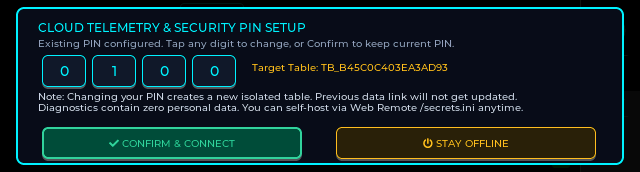

# 🎧 TuneBar (Advanced Edition) — Autonomous AI Voice Assistant & Smart Media Bar


-green)


**TuneBar Advanced Edition** is an extensive architectural evolution of the TuneBar project for the official [Waveshare ESP32-S3-Touch-LCD-3.49](https://docs.waveshare.com/ESP32-S3-Touch-LCD-3.49?variant=ESP32-S3-Touch-LCD-3.49) development platform. What began as a palm-sized internet radio has been re-engineered into an autonomous **AI Voice Assistant**, smart media bar, and distributed telemetry station with high-fidelity acoustic processing, advanced power management, robust DRAM memory engineering, 6-language international radio, LAN media streaming, zero-bitmap procedural vector themes, and complete privacy controls.

---

## 📑 Quick Navigation

* [📦 Hardware Overview](#-hardware-overview)
* [📸 Interface Showcase (Authentic Hardware Captures)](#-interface-showcase)
* [⚡ Quickstart & Flash Guide](#-quickstart--flash-guide)
* [📚 Detailed Technical Documentation](#-detailed-technical-documentation)
* [🛒 Where to Buy Genuine Hardware](#-where-to-buy)
* [📜 Credits & License](#-credits--license)

---

## 📦 Hardware Overview

TuneBar runs on the 3.49-inch capacitive touch screen development board powered by the **ESP32-S3R8** (dual-core 240 MHz, 16MB Flash, 8MB OPI PSRAM) with an integrated acoustic front-end (dual MEMS microphones + ES7210 ADC), audio codec (ES8311 DAC + NS4150B amplifier), 6-axis IMU, and RTC:

<p align="center">
  
  
</p>
<p align="center">
  
  
</p>

*Complete pinouts, wiring diagrams, and silicon driver workarounds are documented in [docs/HARDWARE_AND_DRAM.md](docs/HARDWARE_AND_DRAM.md).*

---

## 📸 Interface Showcase

*All captures shown below are 100% genuine uncompressed framebuffers extracted directly from the physical ESP32-S3 hardware via `/api/screenshot`.*

### 1. Retro Nixie Digital Clock Face

Authentic retro glowing Nixie tube display driven by the hardware PCF85063 RTC with real-time day/date and hardware battery telemetry (voltage and percentage). Features gentle sine-wave breathing PWM dimming and powers down the Wi-Fi modem during idle to conserve battery life.

---

### 2. Live Weather, AQI & Climate Panel

Ambient climate station displaying live weather conditions, temperature ($^\circ\text{C}$ or $^\circ\text{F}$), relative humidity, local wind speed, animated icons, and an integrated US AQI / PM2.5 particulate monitor with color-coded safety indices.

---

### 3. Retro Alarm Clock

Dedicated emerald-green retro alarm interface with independent hour/minute adjustments, armed status toggling, and an acoustic audit button to test the NS4150B amplifier and 8Ω speaker.

---

### 4. Main Menu Carousel (Neon Cards)


Ultra-crisp $640\times172$ horizontal launcher carousel featuring 6 custom neon cards: **CLIMATE** (Cyan), **RADIO** (Pink), **MUSIC** (Purple), **AI VOICE** (Emerald Green), **SYSTEM** (Amber Gold), and **SETTINGS** (Slate). When audio is playing, the active card gently breathes with a soft luminance curve.

---

### 5. Multilingual Global Internet Radio Player


International live-streaming internet radio player supporting 6 world languages (**HI**, **EN**, **ES**, **CN**, **DE**, **JA**) with dynamic language badge indicators, standardized 64 KB prebuffering, and seamless background streaming.

---

### 6. Media Player Subsystem — Local SD & LAN Streaming


Unified media engine with single-tap source switching between **LOCAL SD** (purple neon glow, $O(1)$ PSRAM seek) and **LAN STREAM** (cyan neon glow, local Wi-Fi HTTP streaming).

---

### 7. Autonomous AI Voice Assistant

Full-duplex conversational voice interface utilizing the onboard dual ES7210 MEMS microphones, hardware voice activity detection (VAD), Groq Whisper STT (<200ms), Llama 3.3 70B reasoning, and neural speech streaming.

---

### 8. System Diagnostics, Hardware Utilities & Firmware OTA
<p align="center">
  
</p>

Four dedicated system tools: **Torch** (100% white backlight flashlight), **System Info** (live DRAM/PSRAM meters, FreeRTOS tasks, battery telemetry), **Spirit Level** (6-axis inclinometer), and **Firmware OTA** (on-device community release manager).

---

### 9. Comprehensive Device Settings Suite


Full on-device settings tabs: Wi-Fi network manager (up to 10 saved SSIDs), Screen configuration (**7 procedural vector themes** with zero flash footprint), Music preferences, Region/Timezone configuration, and User Guide.

---

### 10. First-Boot Cloud Registration Modal & Master PIN Setup
<p align="center">
  
  
</p>

Interactive registration modal presented on very first boot: configure a 4-digit Master PIN (or rely on the hardware TRNG default), preview your cryptographically isolated telemetry table hash (`TB_<hash>`), and choose whether to connect or operate 100% offline.

---

## ⚡ Quickstart & Flash Guide

### 1. Clone & Set Up Secrets Template
```bash
git clone https://github.com/rahulraj80/TuneBar.git
cd TuneBar

# Set up secrets template
cp sketch/include/secrets_example.h sketch/include/secrets.h
```

### 2. Compile via PlatformIO
```bash
pio run -d sketch
```

### 3. Flash to Board via USB
Connect the board to your PC via USB-C:
```bash
# Upload firmware
pio run -d sketch -t upload

# Open safe non-resetting serial monitor
python scripts/safe_serial_monitor.py listen --duration 20
```

---

## 📚 Detailed Technical Documentation

To keep this overview concise, detailed architecture guides are organized in the [`docs/`](docs/) directory:

* **[🎙️ Autonomous AI Voice Assistant & Self-Hosting Guide](docs/AI_VOICE_ASSISTANT.md)**: Voice pipeline architecture, self-hosting FastAPI reference server, and community bandwidth notices.
* **[🔒 Privacy, First-Boot Consent & Telemetry](docs/CONSENT_AND_TELEMETRY.md)**: Hardware TRNG PIN setup, SHA256 isolated database tables, and `/secrets.ini` configuration.
* **[📖 Touch Gestures & Complete User Guide](docs/USER_GUIDE.md)**: Comprehensive gesture maps, screen switching hierarchies, and settings configuration.
* **[⚡ Hardware Pinouts, Silicon Quirks & DRAM Optimization](docs/HARDWARE_AND_DRAM.md)**: Deep-dive into ES7210 clock divider fixes, DMA frame stride unpacking, and FreeRTOS PSRAM optimization.
* **[🌐 Web Remote REST API & Serial CLI](docs/REST_API_AND_CLI.md)**: Complete table of embedded HTTP REST endpoints and interactive USB CLI commands.
* **[📐 6-Axis IMU, Spirit Level & Auto-Rotation](docs/IMU_AND_SPIRIT_LEVEL.md)**: Inclinometer physics, bullseye bubble mechanics, and 8-step guided calibration wizard.
* **[⚡ On-Device Multi-Repo Firmware OTA Manager](docs/FIRMWARE_OTA.md)**: Split carousel UI, dynamic GitHub catalog generation, and battery safety guards.

---

## 🛒 Where to Buy Genuine Hardware

For makers looking to replicate this device:
* **🇮🇳 India (Hindi / HI)**: [Evelta Electronics](https://www.evelta.com) (Search SKU `061-32374` / *Waveshare ESP32-S3 Touch LCD 3.49*).
* **🌐 Global / North America (English / EN & Spanish / ES)**: [Waveshare Official Store](https://www.waveshare.com/esp32-s3-touch-lcd-3.49.htm) and official stores on AliExpress.
* **🇪🇺 Europe / DACH (German / DE)**: [BerryBase](https://www.berrybase.de) and [Welectron](https://www.welectron.com).
* **🇯🇵 Japan (Japanese / JA)**: [Switch Science](https://www.switch-science.com).

*Community Notice: None of the above are affiliate links; links are provided strictly for maker convenience.*

---

## 📜 Credits & License

* Original TuneBar project by **[VaAndCob](https://github.com/VaAndCob/TuneBar)**.
* Core audio functionality powered by the **[ESP32-audioI2S](https://github.com/schreibfaul1/ESP32-audioI2S)** library.
* UI engine powered by **[LVGL 8.4.0](https://lvgl.io/)**.
* Advanced Audio Engineering, ES7210 driver fixes, DRAM optimization, power saving architecture, multilingual radio expansion, and AI Voice Assistant by **Rahul Raj** ([@rahulraj80](https://github.com/rahulraj80)).

This software and firmware codebase is licensed under the **GNU General Public License v3.0 (GPL-3.0)** (see [`LICENSE`](LICENSE)). Any hardware designs, UI assets, and media components derived from upstream TuneBar remain licensed under the [Creative Commons Attribution-NonCommercial-ShareAlike 4.0 International (CC BY-NC-SA 4.0)](https://creativecommons.org/licenses/by-nc-sa/4.0/) license. Attribution to original author Va&Cob and contributing author Rahul Raj is required on all derivative distributions.
