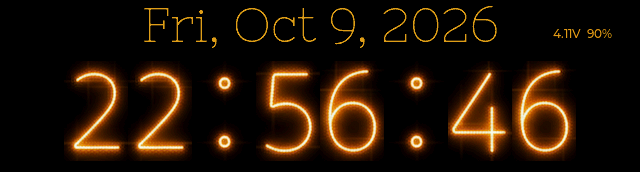
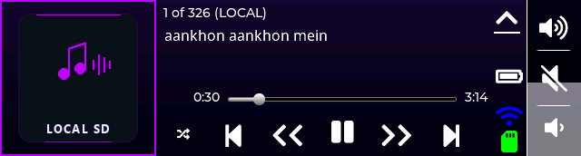
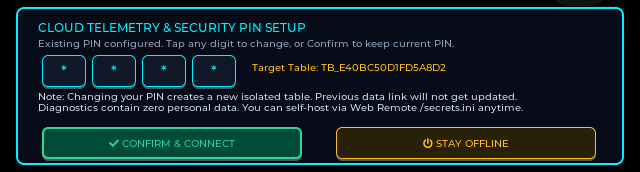

# 🎧 TuneBar (Advanced Edition) — Autonomous AI Voice Assistant & Smart Media Bar


-green)


**TuneBar Advanced Edition** is an extensive architectural evolution of the TuneBar project for the official [Waveshare ESP32-S3-Touch-LCD-3.49](https://docs.waveshare.com/ESP32-S3-Touch-LCD-3.49?variant=ESP32-S3-Touch-LCD-3.49) development platform. What began as a palm-sized internet radio has been re-engineered into an autonomous **AI Voice Assistant**, smart media bar, and distributed telemetry station with high-fidelity acoustic processing, advanced power and breathing profile management, dynamic crowd-sourced battery discharge calibration, 6-axis digital spirit level, 6-language international radio, local SD & LAN media streaming, zero-bitmap procedural vector themes, and complete privacy controls.

---

## 📑 Quick Navigation

* [📦 Hardware Overview](#-hardware-overview)
* [📸 Interface Showcase (Authentic Hardware Captures)](#-interface-showcase)
* [⚡ Quickstart & Flash Guide](#-quickstart--flash-guide)
* [📚 Detailed Technical Documentation](#-detailed-technical-documentation)
* [🛒 Where to Buy Genuine Hardware](#-where-to-buy)
* [📜 Credits & License](#-credits--license)
* [☕ Support the Development](#-support-tunebar-advanced-ai-edition)

---

## 📦 Hardware Overview

TuneBar runs on the 3.49-inch capacitive touch screen development board powered by the **ESP32-S3R8** (dual-core 240 MHz, 16MB Flash, 8MB OPI PSRAM) with an integrated acoustic front-end (dual MEMS microphones + ES7210 ADC), audio codec (ES8311 DAC + NS4150B amplifier), 6-axis IMU, and RTC:

<p align="center">
  
  
</p>
<p align="center">
  
  
</p>

*Complete pinouts, wiring diagrams, and silicon driver workarounds are documented in [docs/HARDWARE_AND_DRAM.md](docs/HARDWARE_AND_DRAM.md).*

---

## 📸 Interface Showcase

*All captures shown below are 100% genuine uncompressed framebuffers extracted directly from the physical ESP32-S3 hardware via `/api/screenshot`.*

<p align="center">
  
  <br>
  <em>Live hardware captures cycling through all 14 applications (3.0s transition).</em>
</p>

| Ambient, Time & Core Utilities | Media, AI & System Management |
| :--- | :--- |
| **Retro Nixie Digital Clock Face**<br>[](document/screen_clock.png)<br>Authentic retro glowing Nixie tubes, hardware RTC precision, real-time date/battery telemetry, and sine PWM breathing dimming. | **Multilingual Global Internet Radio**<br>[](document/screen_radio_player_hi.png)<br>Live streaming across 6 world languages (**HI**, **EN**, **ES**, **CN**, **DE**, **JA**) with dynamic catalog selection and background audio. |
| **Live Climate, Weather & AQI Station**<br>[](document/screen_weather.png)<br>Live weather conditions, temperature, humidity, local wind speed, and real-time US AQI / PM2.5 index with color safety indicators. | **Local SD & LAN Music Player**<br>[](document/screen_music_playing.png)<br>$O(1)$ PSRAM seek for local SD FATFS tracks + Wi-Fi HTTP LAN music streaming with DMA bounce-buffer protection. |
| **Retro Alarm Clock Interface**<br>[](document/screen_alarm.png)<br>Emerald-green retro alarm interface with independent hour/minute adjustments, armed status toggling, and acoustic audit test. | **Autonomous AI Voice Assistant**<br>[](document/screen_assistant.png)<br>Conversational voice interface: dual MEMS mic capture, Groq Whisper STT (<200ms), Llama 3.3 70B reasoning, and neural TTS. |
| **6-Axis Digital Spirit Level & Inclinometer**<br>[](document/screen_spirit_level_panel1.png)<br>QMI8658 6-axis IMU bullseye inclinometer, roll/pitch display, and 8-step guided 3D calibration wizard. | **Power & Breathing Profile Manager**<br>[](document/screen_power_profile.png)<br>Scrollable control panel for breathing duty/timings, service gating, and crowd-sourced cloud battery discharge curve fitting. |
| **System Utilities & App Launcher (5 Apps)**<br>[](document/screen_utility_5apps.png)<br>Dedicated tools launcher: Torch flashlight, System Info diagnostics, Spirit Level, Power Profile, and Firmware OTA. | **On-Device Firmware OTA Manager**<br>[](document/screen_ota_carousel.png)<br>Multi-repo community releases, dynamic GitHub catalog generation, SHA256 integrity verification, and battery safety interlocks. |
| **Procedural Vector Display Themes**<br>[](document/screen_settings_screen.png)<br>7 math-generated procedural vector themes (Amber, Emerald, Cyan, Ruby, Lavender, Gold, Monochrome) with 0 bytes flash cost. | **First-Boot Security & Master PIN Setup**<br>[](document/screen_consent_modal.png)<br>Hardware TRNG PIN setup, isolated SHA256 telemetry tables (`TB_<hash>`), and complete offline mode toggle. |

---

## ⚡ Quickstart & Flash Guide

### 1. Clone & Set Up Secrets Template
```bash
git clone https://github.com/rahulraj80/TuneBar.git
cd TuneBar

# Set up secrets template
cp sketch/include/secrets_example.h sketch/include/secrets.h
```

### 2. Compile via PlatformIO
```bash
pio run -d sketch
```

### 3. Flash to Board via USB
Connect the board to your PC via USB-C:
```bash
# Upload firmware
pio run -d sketch -t upload

# Open safe non-resetting serial monitor
python scripts/safe_serial_monitor.py listen --duration 20
```

---

## 📚 Detailed Technical Documentation

To keep this overview concise, detailed architecture guides are organized in the [`docs/`](docs/) directory:

* **[🎙️ Autonomous AI Voice Assistant & Self-Hosting Guide](docs/AI_VOICE_ASSISTANT.md)**: Voice pipeline architecture, self-hosting FastAPI reference server, and community bandwidth notices.
* **[🔒 Privacy, First-Boot Consent & Telemetry](docs/CONSENT_AND_TELEMETRY.md)**: Hardware TRNG PIN setup, SHA256 isolated database tables, and `/secrets.ini` configuration.
* **[📖 Touch Gestures & Complete User Guide](docs/USER_GUIDE.md)**: Comprehensive gesture maps, screen switching hierarchies, and settings configuration.
* **[⚡ Hardware Pinouts, Silicon Quirks & DRAM Optimization](docs/HARDWARE_AND_DRAM.md)**: Deep-dive into ES7210 clock divider fixes, DMA frame stride unpacking, and FreeRTOS PSRAM optimization.
* **[🌐 Web Remote REST API & Serial CLI](docs/REST_API_AND_CLI.md)**: Complete table of embedded HTTP REST endpoints and interactive USB CLI commands.
* **[📐 6-Axis IMU, Spirit Level & Auto-Rotation](docs/IMU_AND_SPIRIT_LEVEL.md)**: Inclinometer physics, bullseye bubble mechanics, and 8-step guided calibration wizard.
* **[⚡ On-Device Multi-Repo Firmware OTA Manager](docs/FIRMWARE_OTA.md)**: Split carousel UI, dynamic GitHub catalog generation, and battery safety guards.

---

## 🛒 Where to Buy Genuine Hardware

For makers looking to replicate this device:
* **🇮🇳 India (Hindi / HI)**: [Evelta Electronics](https://www.evelta.com) (Search SKU `061-32374` / *Waveshare ESP32-S3 Touch LCD 3.49*).
* **🌐 Global / North America (English / EN & Spanish / ES)**: [Waveshare Official Store](https://www.waveshare.com/esp32-s3-touch-lcd-3.49.htm) and official stores on AliExpress.
* **🇪🇺 Europe / DACH (German / DE)**: [BerryBase](https://www.berrybase.de) and [Welectron](https://www.welectron.com).
* **🇯🇵 Japan (Japanese / JA)**: [Switch Science](https://www.switch-science.com).

*Community Notice: None of the above are affiliate links; links are provided strictly for maker convenience.*

---

## 📜 Credits & License

* Original TuneBar project by **[VaAndCob](https://github.com/VaAndCob/TuneBar)**.
* Core audio functionality powered by the **[ESP32-audioI2S](https://github.com/schreibfaul1/ESP32-audioI2S)** library.
* UI engine powered by **[LVGL 8.4.0](https://lvgl.io/)**.
* Advanced Audio Engineering, ES7210 driver fixes, DRAM optimization, power saving architecture, multilingual radio expansion, and AI Voice Assistant by **Rahul Raj** ([@rahulraj80](https://github.com/rahulraj80)).

This software and firmware codebase is licensed under the **GNU General Public License v3.0 (GPL-3.0)** (see [`LICENSE`](LICENSE)). Any hardware designs, UI assets, and media components derived from upstream TuneBar remain licensed under the [Creative Commons Attribution-NonCommercial-ShareAlike 4.0 International (CC BY-NC-SA 4.0)](https://creativecommons.org/licenses/by-nc-sa/4.0/) license. Attribution to original author Va&Cob and contributing author Rahul Raj is required on all derivative distributions.

---

## ☕ Support TuneBar (Advanced AI Edition)

TuneBar is free and open-source. [Click here to support the Original Repo by VaAndCob](https://github.com/VaAndCob/TuneBar#license)

If you enjoyed the Advanced Edition with the new AI and Smart Features - please click below to support the continued development of the TuneBar (Advanced Edition) — Autonomous AI Voice Assistant & Smart Media Bar.

Every little bit helps keep the project active and maintained.

<p align="center">
  <a href="https://razorpay.me/@rahulraj593" target="_blank" rel="noopener noreferrer">
    
  </a>
</p>

*International supporters: click the card above to pay by card or PayPal via Razorpay. In India: scan the UPI QR in the card, or pay to **`rahul.raj@okicici`**.*
