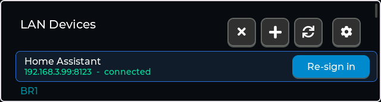
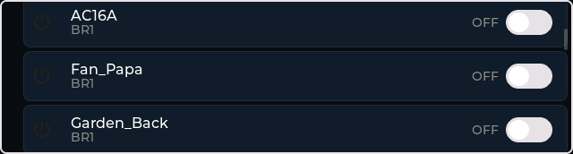
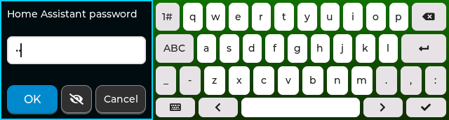
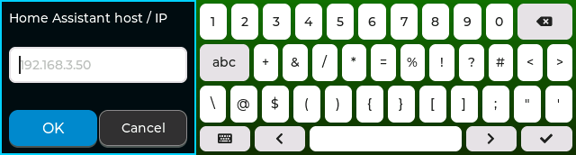

# 🏠 LAN Devices — Home Assistant Control from the Desk

The **LAN DEVICES** card (blue, between **AI VOICE** and **SYSTEM**) lists and controls your Home Assistant lights, switches, covers and fans, plus temperature/humidity sensors, grouped by room. Everything is plain local HTTP — no cloud, no SSH.

<p align="center">
  
  
</p>

## Setup (no token hunting)

1. Open **LAN DEVICES**. Home Assistant is found automatically over mDNS (`_home-assistant._tcp`) and shown as a row with its address and status.
2. Tap **Sign in** on the row (or **+**). Enter your Home Assistant **username**, then **password**. The eye button between **OK** and **Cancel** shows/hides the password.
3. The device list loads, grouped by Home Assistant area (room). Use the switch on each row to toggle it. **⟳** refreshes, **⚙** adds a generic HTTP agent.

<p align="center">
  
  
</p>

- Only a **refresh token** is stored on the device (NVS namespace `lan_dev`); your password is never stored. The short-lived access token renews itself automatically.
- Two-factor accounts are not supported by the login flow — leave the username empty to paste a **long-lived access token** instead (Home Assistant → profile → Security).
- Status per server: *not signed in*, *signed in*, *connected*, or *unreachable / sign-in failed*.

## Keyboard

The sign-in keyboard is 422 px wide with three tall key rows and a shorter bottom row (keyboard, ←, space, →, ✓). Port steps use a numeric pad.

## How it works

| Action | Home Assistant call |
|---|---|
| Discover | mDNS `_home-assistant._tcp` |
| Sign in | `POST /auth/login_flow` → `/auth/login_flow/<id>` → `/auth/token` |
| Device list | one `POST /api/template` (lights/switches/covers/fans + temperature/humidity sensors **with area**); falls back to a filtered `GET /api/states` for non-admin users |
| Toggle | `POST /api/services/<domain>/<service>` |

All network work runs on background tasks so the touch UI stays responsive.

## Serial CLI

```
lan open | lan close                    # open/close the screen
lan mdns                                # query mDNS for Home Assistant
lan login <host> <port> <user> <password>
lan add <host> <port> <token> [ssl]     # add a server with a long-lived token
lan agent add <name> <host> <port> [base]
lan list | lan refresh | lan toggle <entity_id> | lan remove <index>
```

See also the engineering notes in [guide.md](guide.md).
